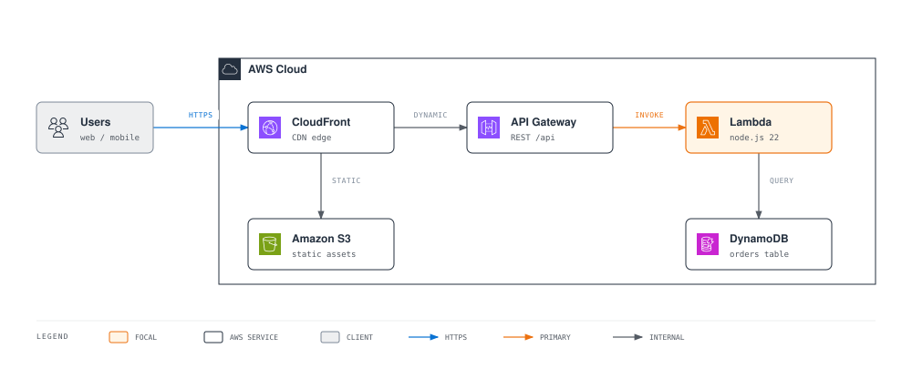
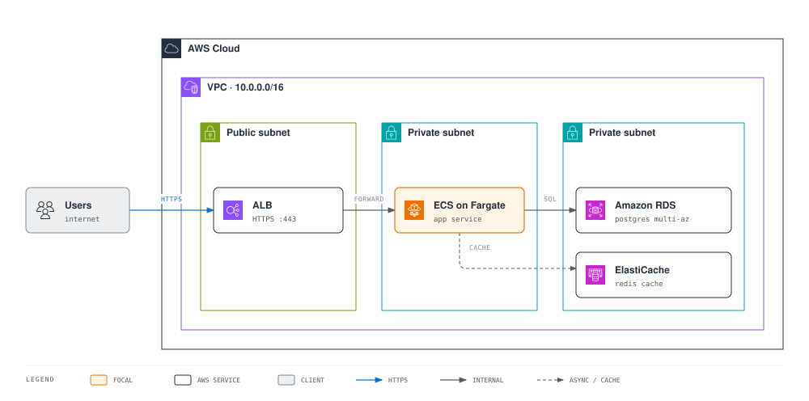
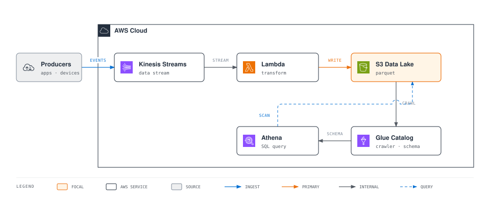
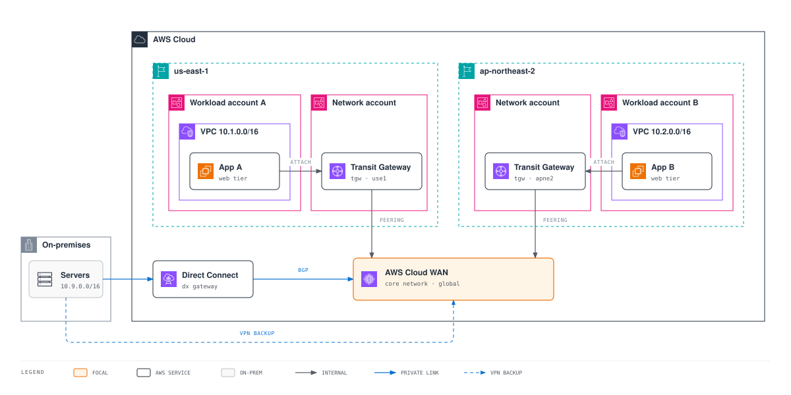
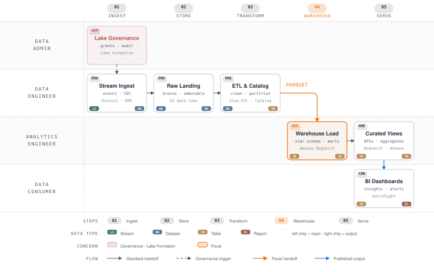

# AWS Diagram Design Skill (aws-diagram-design)

**Português** | [한국어](README.ko.md) | [English](README.en.md)

**Descreva em palavras e receba um diagrama AWS.**

Em vez de desenhar arquiteturas à mão no draw.io, peça ao Claude Code ou ao Kiro:

> "Desenhe um diagrama de VPC em três camadas: serviço Fargate atrás de um ALB, com RDS Multi-AZ e ElastiCache"

O resultado é um diagrama em HTML autocontido com os [AWS Architecture Icons oficiais](https://aws.amazon.com/architecture/icons/), a tipografia Amazon Ember e as convenções oficiais de contêineres de VPC / sub-rede / conta. Ele pode ser exportado para SVG/PNG quando você quiser. O objetivo é uma qualidade que você possa usar direto em propostas, wikis, apresentações e revisões de arquitetura.

## O que ele desenha

- **Diagramas de arquitetura**: serverless, redes VPC, multi-conta / multi-região, híbrido (Direct Connect / VPN). Os limites de VPC, sub-rede, Region e conta seguem as convenções oficiais de cores e selos dos contêineres de grupo.
- **Todo o resto que seus documentos de design precisam**: fluxogramas, diagramas de sequência, máquinas de estados, ER, linhas do tempo, swimlanes, Gantt, organogramas, pilhas de camadas, fluxos de dados — 27 tipos visuais no total.
- **Redesenho de diagramas existentes**: lê seus arquivos draw.io (.drawio) ou Mermaid (.mmd) e os redesenha no tamanho e nível de detalhe que você escolher (documento / slide / resumo), preservando o conteúdo.

Todo nó que nomeia um serviço AWS recebe o ícone oficial, em qualquer tipo de diagrama, e não só nos de arquitetura. O design system editorial é contido (baseado em [cathrynlavery/diagram-design](https://github.com/cathrynlavery/diagram-design)) e limita a ênfase a um ou dois elementos focais em smile orange.

## Galeria

Tudo abaixo foi gerado por esta skill. Os HTML originais estão em [docs/samples/](docs/samples/).

### Serverless Web Application

O ponto de partida mais comum. O CloudFront divide o tráfego entre os assets estáticos no S3 e o caminho dinâmico API Gateway → Lambda → DynamoDB. ([HTML](docs/samples/serverless-web-app.html))



### VPC Three-Tier Web Service

ALB em sub-rede pública → ECS on Fargate em sub-rede privada → RDS e ElastiCache em sub-rede de dados. As cores e os selos dos limites de sub-rede seguem exatamente a convenção oficial. ([HTML](docs/samples/vpc-three-tier.html))



### Event-Driven Data Pipeline

Ingestão por streaming Kinesis → Lambda → data lake no S3, mais um caminho de análise em que o Athena consulta o S3 diretamente pelo catálogo do Glue. Os conectores que se cruzam usam o primitivo bridge/hop. ([HTML](docs/samples/event-driven-pipeline.html))



### Multi-Region Network Backbone

O formato típico de uma rede multi-conta e multi-região. Os Transit Gateways de cada região, nas contas de rede, fazem peering com um núcleo AWS Cloud WAN. O ambiente on-premises se conecta por Direct Connect (BGP), com Site-to-Site VPN de backup. ([HTML](docs/samples/multi-region-network.html))



### AWS Data Pipeline Flow

Um fluxo de dados por papéis que mostra quem faz o quê em cada etapa. O Data Admin define a governança do catálogo no Lake Formation e o acesso no IAM, representados como gatilhos tracejados. Abaixo, o fluxo segue: ingestão Kinesis/DMS → lake no S3 → ETL no Glue → data warehouse no Redshift (a passagem focal) → dashboards no Quick Suite. Cada nó tem o ícone oficial do serviço, e chips de tipo de payload acompanham a transformação (stream → dataset → tabela → relatório). ([HTML](docs/samples/data-pipeline-flow.html))



> O GitHub bloqueia fontes externas ao renderizar imagens, então os SVGs acima aparecem com fontes do sistema. Abra os HTML no navegador para ver a tipografia Amazon Ember real.

## Primeiros passos

> **Segurança:** antes de instalar, veja a [revisão de segurança](docs/revisao-seguranca.md). Resumo: nenhum código malicioso foi encontrado, e o `install.sh` não baixa nada da internet.

### Kiro (IDE / CLI / Web)

Siga o guia de **[instalação manual no Kiro](docs/instalacao-kiro.md)**. Ele não usa o `install.sh`, cobre instalação no workspace, no usuário, pela IDE, como Power e no Kiro Web, e inclui adaptações para o Kiro: comandos de importação/exportação e hook de validação.

Se preferir o script, ele faz a mesma cópia:

```bash
./install.sh kiro            # copia para ~/.kiro/skills/ (--workspace: no projeto, --link: symlink)
```

O Kiro lê Agent Skills no formato da Anthropic de forma nativa, sem conversão. Mais detalhes em [docs/guide-kiro.md](docs/guide-kiro.md).

### Claude Code

```
/plugin marketplace add masangbeom/aws-diagram-design
```
```
/plugin install aws-diagram-design@aws-diagram-design
```
```
/reload-plugins
```

> `masangbeom/aws-diagram-design` é o repositório **original** (upstream). Para usar exatamente o código revisado deste fork, registre um clone local: `/plugin marketplace add /caminho/para/aws-diagram-design`.

### Fontes (opcional)

```bash
./install.sh fonts           # instala os TTF da Amazon Ember incluídos na pasta de fontes do sistema
```

A instalação manual, sem o script, está na seção 8 de [docs/instalacao-kiro.md](docs/instalacao-kiro.md).

A Amazon Ember vem incluída na skill, a partir da [distribuição oficial da Amazon](https://developer.amazon.com/en-US/alexa/branding/echo-guidelines/identity-guidelines/typography) (`skills/aws-diagram-design/assets/fonts/`). Os diagramas gerados procuram a fonte nesta ordem: instalação local → woff2 incluído → Helvetica. Por isso tudo funciona mesmo sem esta etapa.

## Como usar

Basta pedir em linguagem natural. A skill reconhece gatilhos em português, inglês e coreano (diagrama de arquitetura, fluxograma, diagrama de sequência etc.):

```
"Desenhe a arquitetura deste projeto — ArgoCD no EKS, RDS Multi-AZ"
"Diagrama de rede hub-and-spoke com Transit Gateway, três contas"
"Diagrama de sequência do processamento de pedidos na AWS — API Gateway, Lambda, SQS, DynamoDB"
"Transforme este processo de onboarding em um swimlane"
```

Redesenho de arquivos existentes e exportação:

| Ação | Claude Code | Kiro (com os steerings de `kiro/steering/`) |
|---|---|---|
| Redesenhar draw.io | `/aws-diagram-design:import-drawio legado.drawio` | `/aws-import-drawio legado.drawio` |
| Redesenhar Mermaid | `/aws-diagram-design:import-mermaid pipeline.mmd` | `/aws-import-mermaid pipeline.mmd` |
| Exportar HTML para SVG/PNG | `/aws-diagram-design:export-diagram meu-diagrama.html` | `/aws-export-diagram meu-diagrama.html` |

Em qualquer ambiente, também funciona pedir em linguagem natural ("redesenhe este .drawio para slide").

No redesenho, você escolhe o tamanho (documento inline / largo / slide 16:9 / card social), o nível de detalhe (faithful / balanced / simplified) e o público (engineer / mixed / executive). Tudo o que for mesclado ou descartado é informado no *fidelity ledger* (registro de fidelidade).

## Recursos oficiais da AWS, usados sem alteração

| Recurso | Detalhes |
|---|---|
| [AWS Architecture Icons](https://aws.amazon.com/architecture/icons/) | Pacote oficial de ícones (release 07312026), 812 ícones incluídos: 305 de serviço, 466 de recurso, 15 de grupo, 26 de categoria. Usados sem modificação nem recoloração, em todos os tipos de diagrama, e não só nos de arquitetura. Galeria: `assets/aws-icons.html` |
| Convenções de contêineres de grupo | Cores de limite, selos e regras de tracejado oficiais para AWS Cloud, contas, Regions, VPCs, sub-redes públicas/privadas, security groups e outros |
| [Amazon Ember](https://developer.amazon.com/en-US/alexa/branding/echo-guidelines/identity-guidelines/typography) | Fontes de distribuição oficial incluídas (woff2 + TTF). Junto com a paleta squid ink `#232F3E` + smile orange `#EC7211`/`#FF9900`, formam a skin da marca AWS |

## Estrutura do repositório

```
aws-diagram-design/
├── .claude-plugin/                 # manifesto do plugin do Claude Code + catálogo do marketplace
├── plugin.json                     # manifesto Agent Plugins (Power do Kiro)
├── commands/                       # slash commands do Claude Code (import-drawio / import-mermaid / export-diagram)
├── kiro/                           # adaptações para o Kiro: steering (/aws-import-*, /aws-export-diagram) + hook
├── skills/aws-diagram-design/      # skill canônica (comum a todos os ambientes)
│   ├── SKILL.md                    #   design system + roteamento dos 27 tipos
│   ├── references/                 #   especificações por tipo (style-guide, type-*, primitive-aws-icons, …)
│   ├── assets/                     #   templates e exemplos, aws-icons/ 812 SVGs, fonts/ Amazon Ember
│   └── scripts/                    #   autoverificação (self_check, verify-geometry), extratores drawio/mermaid
├── scripts/                        # scripts de verificação do repositório + fixtures de teste
├── docs/                           # guias (Kiro, Claude Code), revisão de segurança, samples/
└── install.sh                      # instalador claude-code · kiro · fonts
```

## Licença

MIT. Os avisos de terceiros estão em [THIRD_PARTY_LICENSES.md](THIRD_PARTY_LICENSES.md). Os AWS Architecture Icons seguem os [termos de uso dos ícones da AWS](https://aws.amazon.com/architecture/icons/), que proíbem modificação e recoloração. A Amazon Ember segue as diretrizes de licença incluídas junto com as fontes.
